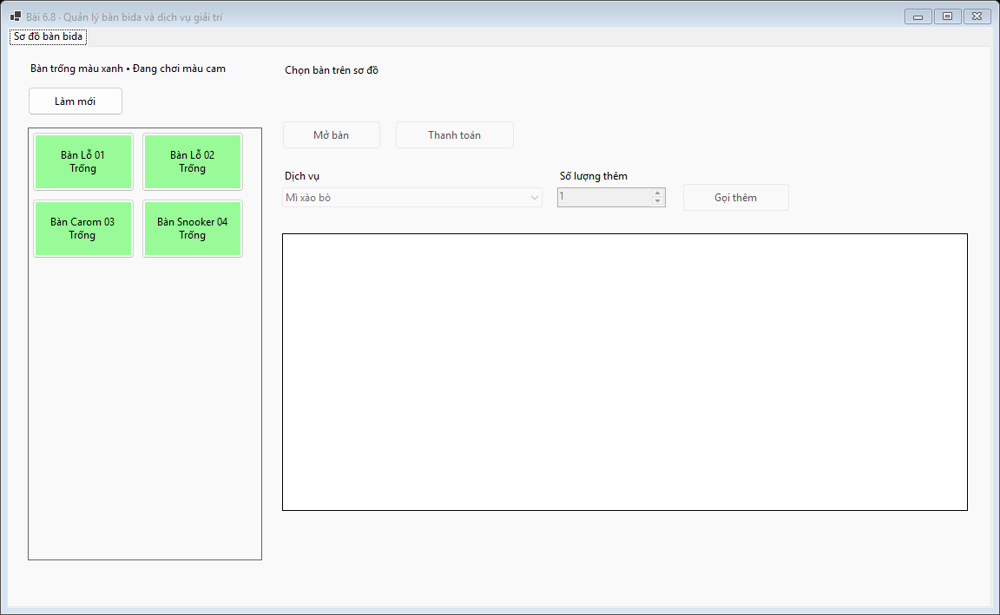
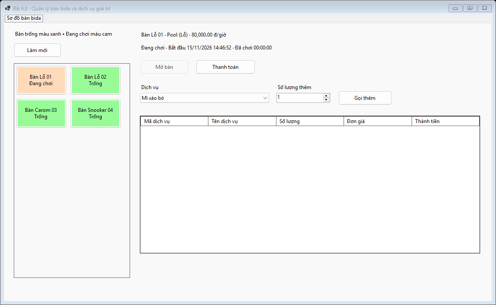
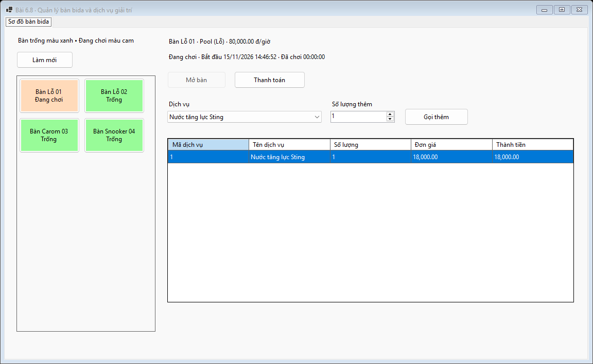
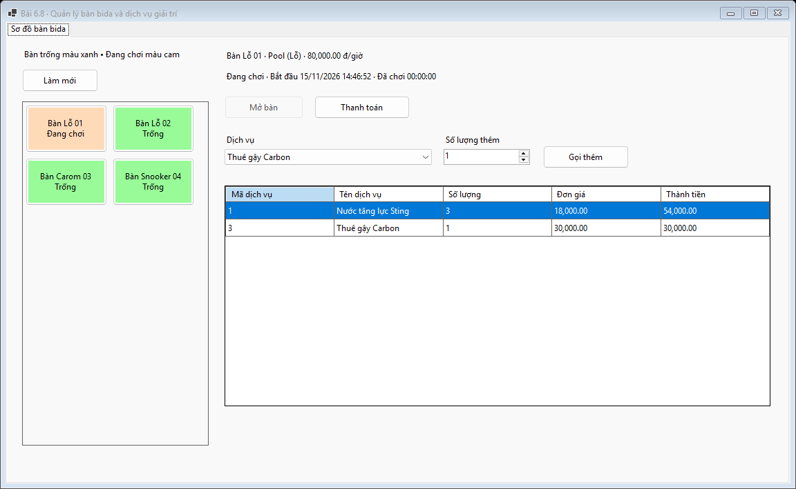

# Bài 6.8 - Hệ thống quản lý bàn bida & dịch vụ giải trí

## Mục 1. Thông tin sinh viên

- Họ và tên sinh viên: Phạm Tuấn Thành
- Mã sinh viên: 24810320264
- Lớp / Khóa: D19QTANM1

### Cách chạy

1. Chạy [Database/ScriptDB.sql](Database/ScriptDB.sql) trên SQL Server để tạo CSDL `BilliardsDB` và dữ liệu mẫu. Ứng dụng mặc định kết nối với `(localdb)\MSSQLLocalDB`.
2. Mở [BilliardsClubManagement.sln](BilliardsClubManagement.sln) trong Visual Studio có workload **.NET desktop development** và SDK .NET 8. Nếu dùng máy chủ khác, cấu hình biến môi trường `BILLIARDSDB_CONNECTION` với chuỗi kết nối đến CSDL đã tạo.
3. Nhấn **F5** để chạy. Trong Solution Explorer, chọn **GUI/MainForm.cs** và chọn **View Designer** để mở giao diện thiết kế.

### Quy tắc đã thống nhất

Tiền giờ tính theo thời gian chơi thực tế và làm tròn đến hai chữ số thập phân. Dịch vụ được lưu khi gọi, trừ tồn khi thanh toán. Dịch vụ thuê gậy dùng `TonKho = NULL`. Khi không đủ tồn, giao dịch hoàn tác và bàn vẫn **Đang chơi**.

## Mục 2. Hình ảnh kết quả các màn hình chức năng

### 1. Sơ đồ bàn bida

### 2. Bàn đang chơi và thời gian bắt đầu

### 3. Dịch vụ đã gọi trên bàn

### 4. Tăng số lượng và thuê gậy

### 5. Kết quả thanh toán

